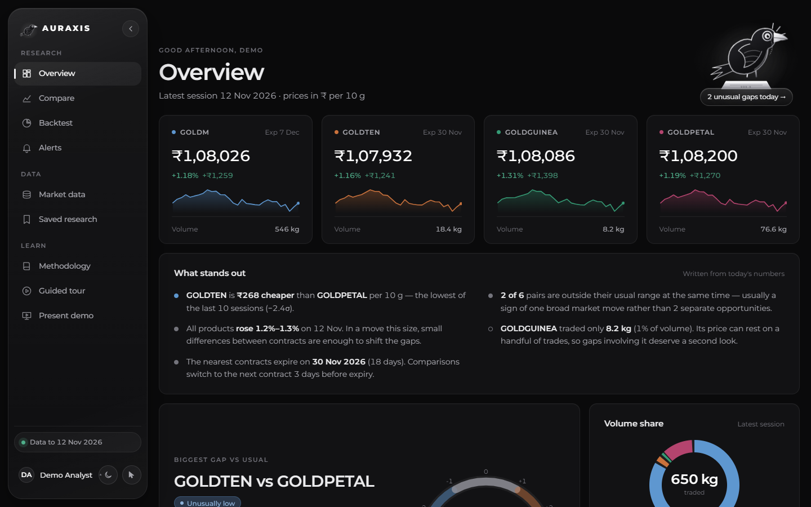
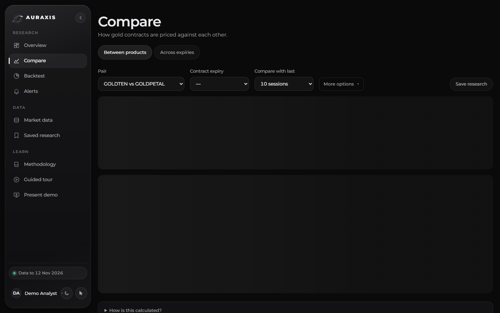
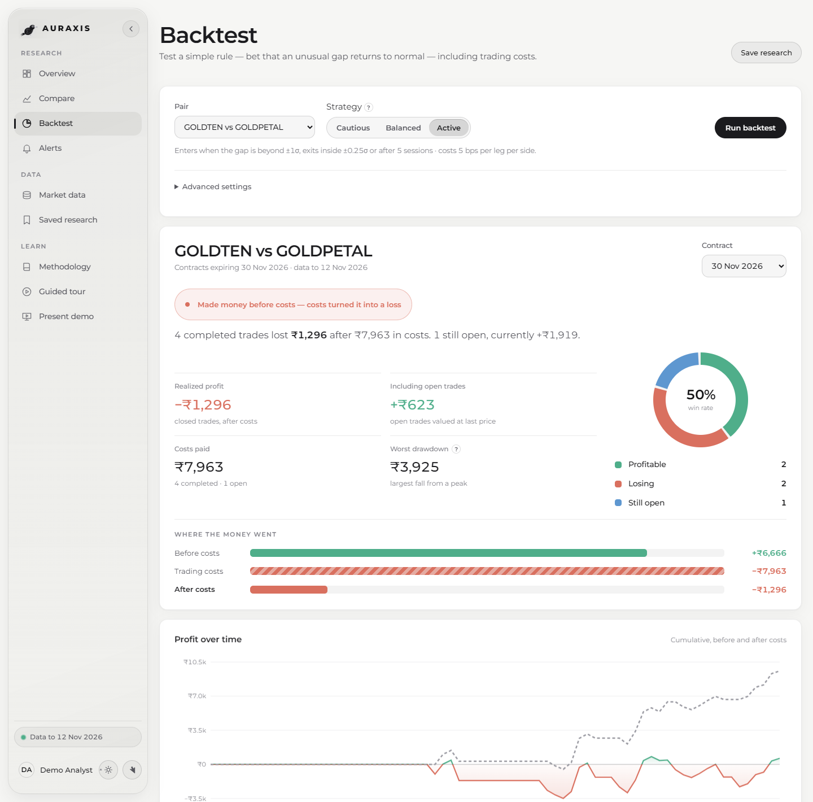
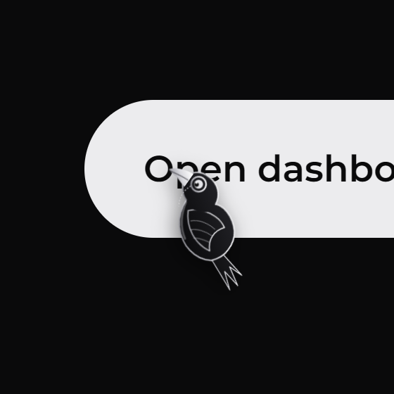

# Auraxis

**Same gold. Different contracts. Is the gap real?**

**[Live app](https://auraxis-production.up.railway.app)** · [Dashboard](https://auraxis-production.up.railway.app/app) · [Sign in / Sign up](https://auraxis-production.up.railway.app/login) · [API health](https://auraxis-production.up.railway.app/health)

Frontend and backend are hosted on Railway behind the same HTTPS origin. The hosted market database starts empty; analytics require an authorized data source.

Auraxis is a research dashboard for MCX gold futures — GOLDM, GOLDTEN,
GOLDGUINEA and GOLDPETAL. It puts every contract on one price basis
(₹ per 10 g of 999 gold), ranks each price gap against its own recent history,
explains what stands out in plain English, and backtests a simple
"gap returns to normal" rule — with trading costs.


> Historical research tool using MCX settlement prices — not live trading, not
> investment advice. All screenshots use a **synthetic sample dataset**; no
> MCX data is included in this repository.

## Highlights

- **One price scale** — every contract converted to ₹ per 10 g, side by side.
- **"Is it unusual?"** — each gap scored against its own last 10 sessions (σ),
  shown on a gauge and ranked across all six pairs.
- **Plain-English insights** — findings written from the numbers by fixed
  rules (no AI), so every sentence traces back to a figure.
- **Honest backtests** — every simulated trade pays costs; the page shows
  where the money went, including when costs turn a profit into a loss.
- **Shareable research notes** — one click to a printable PDF report.
- **Demo mode** — an 8-step guided presentation with live numbers.
- **Automatic data** — MCX Bhavcopy files saved to your Downloads folder are
  imported within seconds; Upstox auto-refresh is built in.
- **Light & dark themes**, a liquid-glass sidebar and an animated crow mascot
  (which can also be your mouse pointer).

## Tour

### Overview
Prices on one scale, what stands out today, the biggest unusual gap and every
pair ranked. The crow reacts to the data — alert when something is unusual,
sleepy when nothing is.



<details>
<summary>Light theme</summary>


</details>

### Compare
*Between products*: one pair's gap, how unusual it is and its history, with
the full calculation one click away. *Across expiries*: a product's futures
curve and what moved each contract.




### Backtest
Cautious / Balanced / Active presets (or custom settings). A verdict, where the
money went before and after costs, profit over time, each trade, and how
sensitive the result is to costs — with the break-even cost marked.



### Share a research note
Findings, key figures, the chart and caveats on one page — **Download PDF** or
copy the link.


### Demo mode
**Present demo** (sidebar or landing page) walks judges through the story in
8 steps with captions that quote the day's real numbers. Auto-play paces it to
about three minutes; keys: → / Space, ←, P, Esc.


### Mobile and the crow pointer
Every page works on phones. On desktop the crow can replace the mouse pointer —
its beak tip is the exact click point; switch it off next to the theme toggle.

<p>
  
  &nbsp;
  
</p>

## Quick start (Windows PowerShell)

Requires Python 3.12+ and Node 22+. From the repository root:

```powershell
# Backend (terminal 1)
Set-Location backend
py -3.12 -m venv .venv
.\.venv\Scripts\python.exe -m pip install -r requirements.txt
Copy-Item .env.example .env
.\.venv\Scripts\python.exe -m uvicorn app.main:app --port 8010

# Frontend (terminal 2)
Set-Location frontend
npm ci
Copy-Item .env.example .env
npm run dev -- --port 5180
```

Open http://localhost:5180 and create an account. The dashboard guides you to
load data on first run.

## Loading market data

Raw market data is **not** included in this repository (MCX redistribution
permission has not been established). Options:

1. **Auto-import from Downloads (recommended)** — set `BHAVCOPY_WATCH=true` in
   `backend/.env`. While the backend runs, any Bhavcopy CSV you download from
   the [MCX Bhavcopy page](https://www.mcxindia.com/market-data/bhavcopy) is
   imported within seconds, filed under the trade date *inside* the file
   (MCX file names can be wrong), and re-downloads are skipped. Open pages
   refresh themselves.
2. **Import page** — drag CSVs onto **Data → Import**.
3. **Command line** — put CSVs in `backend/data_cache/raw_csv/` and run
   `.\.venv\Scripts\python.exe -m app.data.loader --dir data_cache/raw_csv`.
4. **Upstox (automatic history and daily updates)** — set
   `UPSTOX_ACCESS_TOKEN` to a free, read-only
   [Analytics Token](https://upstox.com/developer/api-documentation/analytics-token/)
   (needs an active Upstox account), then press ↻ in the sidebar or run
   `.\.venv\Scripts\python.exe -m app.data.upstox --days 365`. Rows from MCX
   files are never overwritten.

How much history unlocks what:

| Trading days | What works |
| --- | --- |
| 1 | Prices, volumes, price ladder, gap today, futures curve, data health |
| 2+ | Day-on-day change, sparklines, price trend |
| 6+ | "How unusual" gauge, gap-vs-usual ranking, gap history, σ alerts |
| 20+ | Backtest |

## Configuration

Key `backend/.env` settings (see `backend/.env.example` for all):

| Variable | Purpose |
| --- | --- |
| `BHAVCOPY_WATCH` | Auto-import Bhavcopy CSVs from a folder (default off) |
| `BHAVCOPY_WATCH_DIR` | Folder to watch (default: your Downloads) |
| `UPSTOX_ACCESS_TOKEN` | Enables the Upstox connector and auto-refresh |
| `UPSTOX_INCLUDE_EXPIRED` | Expired-contract history (needs Upstox Plus) |
| `DATA_ADMIN_EMAILS` | Restrict who can import or refresh data |
| `GOOGLE_CLIENT_ID` | Shows "Continue with Google" when set |
| `CORS_ORIGINS` | Allowed frontend origins |
| `AUTH_COOKIE_SECURE` | Set `true` when served over HTTPS |

The frontend reads `VITE_API_BASE_URL` (default `http://localhost:8010`).

## Stack

React 19 · TypeScript · Vite · Recharts — FastAPI · pandas · SQLite.
Themes are driven by CSS custom properties (`frontend/src/styles/theme.css`);
the chart palette was validated for contrast and colour-blind separation on
both themes.

## Checks

```powershell
# backend
.\.venv\Scripts\python.exe -m pytest
.\.venv\Scripts\ruff.exe check .
# frontend
npm run typecheck; npm run lint; npm run build
node --test tests/routes.test.mjs tests/coverage.test.mjs tests/workspaces.test.mjs tests/profile.test.mjs tests/alerts.test.mjs tests/account-security.test.mjs tests/deployment.test.mjs tests/particles.test.mjs
```

`tests/client.test.mjs` and `tests/phase1.test.mjs` assert values from the
original private dataset and need its exported snapshots.

## Limitations

- Prices are daily settlements, not executable quotes; backtests assume
  next-session settlement fills.
- Converting to ₹ per 10 g does not remove location differences (GOLDPETAL is
  quoted ex-Mumbai, the others ex-Ahmedabad). Purity adjustment is
  experimental and off by default.
- GOLDM comparisons interpolate the other product to a matching maturity —
  useful for analysis, not a tradable pair.
- Short histories make "usual level" statistics noisy; load more days for
  meaningful results.

## More documentation

- [Methodology](frontend/src/pages/MethodologyPage.tsx) — also in the app under *Methodology*
- [Demo script](docs/HACKATHON_DEMO.md)
- [Deployment](docs/DEPLOYMENT.md)
- [Account security and alert sync](docs/ACCOUNT_SECURITY_AND_SYNC.md)
- [Contract-basis review](docs/CONTRACT_BASIS_REVIEW_2026-10-28.md)
- [User validation worksheet](docs/USER_VALIDATION.md)
- Historical status reports and audits: [docs/archive](docs/archive)

Licensed under the [LICENSE](LICENSE) in this repository; it does not grant
rights to MCX market data.
