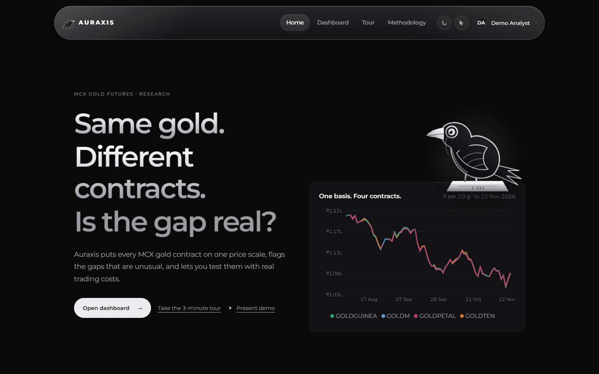
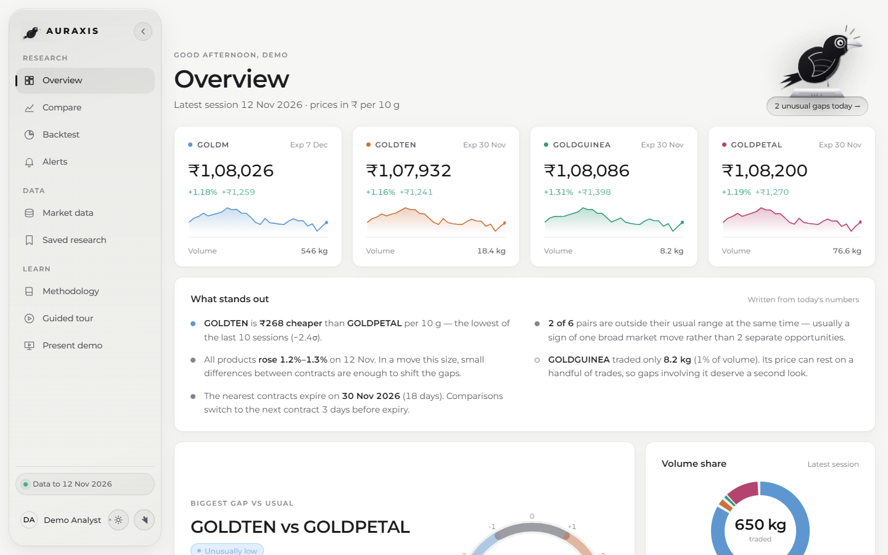
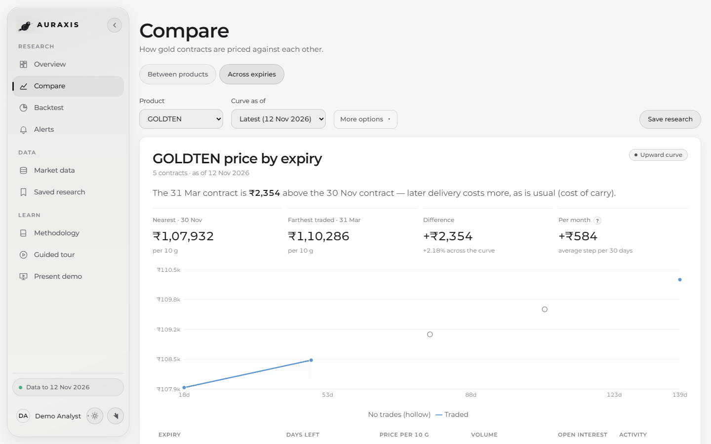
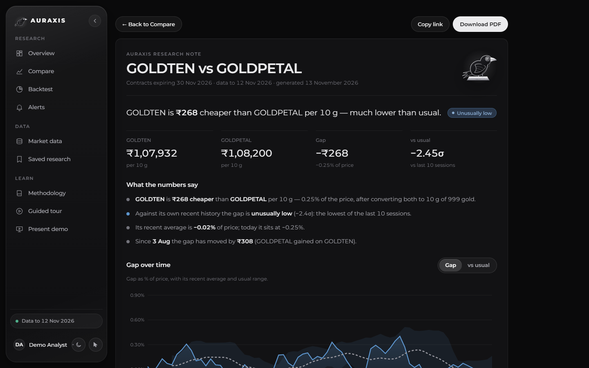
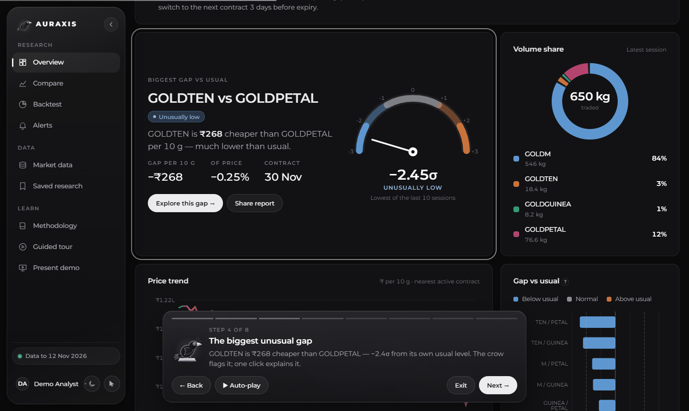
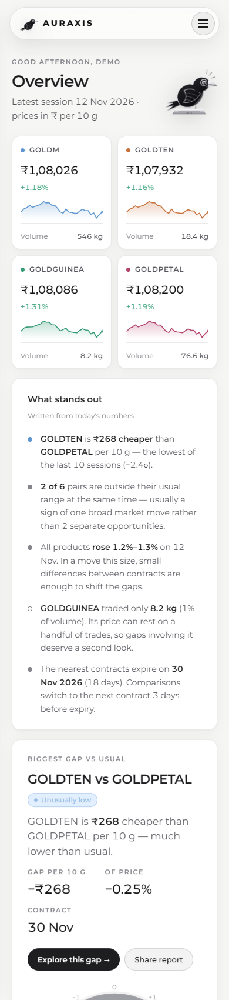

# Auraxis

**Same gold. Different contracts. Is the gap real?**

Auraxis is a research dashboard for MCX gold futures — GOLDM, GOLDTEN,
GOLDGUINEA and GOLDPETAL. It puts every contract on one price basis
(₹ per 10 g of 999 gold), ranks each price gap against its own recent history,
explains what stands out in plain English, and backtests a simple
"gap returns to normal" rule — with trading costs.



> Historical research tool using MCX settlement prices — not live trading, not
> investment advice. All screenshots use a **synthetic sample dataset**; no
> MCX data is included in this repository.

**New here? Read the [user guide](docs/USER_GUIDE.md)** — every page and feature,
step by step.

## Highlights

- **One price scale** — every contract converted to ₹ per 10 g, side by side.
- **"Is it unusual?"** — each gap scored against its own last 10 sessions (σ),
  shown on a gauge and ranked across all six pairs.
- **Plain-English insights** — findings written from the numbers by fixed
  rules (no AI), so every sentence traces back to a figure.
- **Honest backtests** — every simulated trade pays costs; the page shows
  where the money went, including when costs turn a profit into a loss.
- **Shareable research notes** — one click to a printable PDF report.
- **Demo mode** — an 8-step guided presentation with live numbers.
- **Automatic data** — MCX Bhavcopy files saved to your Downloads folder are
  imported within seconds; Upstox auto-refresh is built in.
- **Live market prices** — with an Upstox token, the Overview shows last
  traded prices and provisional gaps that update every 30 seconds while MCX
  is open.
- **Practice with demo money** — every account gets ◎ 10,00,000 of practice
  money (no cash value) to trade gaps or single products at live prices, with
  open P&L, history, achievements and an opt-in leaderboard.
- **On-chain gold** — tokenized gold (PAXG, XAUT) read from Ethereum and
  compared with all four MCX products at India parity (incl. import duty),
  with a year of daily gap history.
- **Proof of research** — practice trades and research notes get salted
  fingerprints, sealed hourly into a Merkle root that is timestamped in
  Bitcoin via OpenTimestamps; anyone can verify a shared proof.
- **Optional wallet link** — connect MetaMask (or any Ethereum wallet) on
  your profile with Sign-In with Ethereum: a free signature, no transaction.
- **Soulbound badges & on-chain anchors (test network)** — earned
  achievements can be claimed as non-transferable ERC-721/ERC-5192 NFTs on
  Base Sepolia, and every proof root is also published to the same
  contract. The server pays the test gas; users sign nothing.
- **Light & dark themes**, a trading-style top bar with search (press `/`) and an animated crow mascot
  (which can also be your mouse pointer).

## Tour

### Overview
Prices on one scale, what stands out today, the biggest unusual gap and every
pair ranked. The crow reacts to the data — alert when something is unusual,
sleepy when nothing is.


<details>
<summary>Light theme</summary>


</details>

### Compare
*Between products*: one pair's gap, how unusual it is and its history, with
the full calculation one click away. *Across expiries*: a product's futures
curve and what moved each contract.




### Backtest
Cautious / Balanced / Active presets (or custom settings). A verdict, where the
money went before and after costs, profit over time, each trade, and how
sensitive the result is to costs — with the break-even cost marked.


### Share a research note
Findings, key figures, the chart and caveats on one page — **Download PDF** or
copy the link.



### Demo mode
**Present demo** (sidebar or landing page) walks judges through the story in
8 steps with captions that quote the day's real numbers. Auto-play paces it to
about three minutes; keys: → / Space, ←, P, Esc.



### Mobile and the crow pointer
Every page works on phones. On desktop the crow can replace the mouse pointer —
its beak tip is the exact click point; switch it off next to the theme toggle.

<p>
  
  &nbsp;
  
</p>

## Quick start (Windows PowerShell)

Requires Python 3.12+ and Node 22+. From the repository root:

```powershell
# Backend (terminal 1)
Set-Location backend
py -3.12 -m venv .venv
.\.venv\Scripts\python.exe -m pip install -r requirements.txt
Copy-Item .env.example .env
.\.venv\Scripts\python.exe -m uvicorn app.main:app --port 8010

# Frontend (terminal 2)
Set-Location frontend
npm ci
Copy-Item .env.example .env
npm run dev -- --port 5180
```

Open http://localhost:5180 and create an account. The dashboard guides you to
load data on first run.

## Loading market data

Raw market data is **not** included in this repository (MCX redistribution
permission has not been established). Options:

1. **Auto-import from Downloads (recommended)** — set `BHAVCOPY_WATCH=true` in
   `backend/.env`. While the backend runs, any Bhavcopy CSV you download from
   the [MCX Bhavcopy page](https://www.mcxindia.com/market-data/bhavcopy) is
   imported within seconds, filed under the trade date *inside* the file
   (MCX file names can be wrong), and re-downloads are skipped. Open pages
   refresh themselves.
2. **Import page** — drag CSVs onto **Data → Import**.
3. **Command line** — put CSVs in `backend/data_cache/raw_csv/` and run
   `.\.venv\Scripts\python.exe -m app.data.loader --dir data_cache/raw_csv`.
4. **Upstox (automatic history and daily updates)** — set
   `UPSTOX_ACCESS_TOKEN` to a free, read-only
   [Analytics Token](https://upstox.com/developer/api-documentation/analytics-token/)
   (needs an active Upstox account), then press ↻ in the sidebar or run
   `.\.venv\Scripts\python.exe -m app.data.upstox --days 365`. Rows from MCX
   files are never overwritten.

### Practice trading (demo money)

Signed-in users get ◎ 10,00,000 of demo money on the **Practice** page (also
reachable from the Overview's Pair check: *Practise this gap*). Trades fill
only at the backend's own live last-traded prices while MCX is open, hold 10%
margin and pay the same 5 bps per leg per side as the backtest. Pair trades
cover the three same-expiry pairs; GOLDM is practised on its own. Demo money
has no cash value and cannot be bought, withdrawn or transferred. Data lives
in `backend/practice.sqlite3` (git-ignored); users can reset any time.

### Proof of research (Bitcoin timestamps)

**More → Proof of research.** Closed practice trades are certified
automatically; saved research notes have a *Certify on Bitcoin* button. Each
record gets a fingerprint `SHA256("auraxis-proof-leaf-v1\0" + 32-byte salt +
exact JSON)`. Every `PROOFS_BATCH_MINUTES` the new fingerprints form a Merkle
tree (`node = SHA256(0x01 + left + right)`); only the root is sent to the free
OpenTimestamps calendars, which commit it to a Bitcoin block within hours.
The backend upgrades pending stamps, checks the attestation against the real
Bitcoin block header, and follows upgrade URLs only on known calendar domains.
A proof file (record + exact JSON + salt + Merkle path + root + `.ots`) can be
verified by anyone on the same page, or independently with the `.txt` and
`.ots` files at opentimestamps.org. No wallet, key or fee is involved.

### On-chain gold (read-only Web3)

**More → On-chain gold** compares tokenized gold with MCX. Each PAXG (Paxos)
or XAUT (Tether) token is one fine troy ounce on Ethereum. The backend reads
token prices every minute (CoinGecko) and each token's circulating supply
directly from its ERC-20 contract on Ethereum mainnet (`totalSupply`,
`decimals` over JSON-RPC). Parity per 10 g = token price ÷ 31.1035 g × 10 ×
(1 + India's import duty on that date; see `ONCHAIN_DUTY_SCHEDULE`). A year of
daily token prices is paired with MCX settlements for the gap history.
Read-only: no wallet, key or transaction is involved.

### Soulbound badges and proof anchors (Base Sepolia test network)

`backend/contracts/AuraxisBadges.sol` (ERC-721 + ERC-5192, every transfer
reverts) has two operator-only functions: `mint(to, badge)` — one token per
badge per wallet, with on-chain JSON metadata — and `anchor(root, batchId)`,
which records `anchoredAt[root] = block.timestamp`. The backend signs
EIP-1559 transactions itself (`app/data/evm.py`: RLP, RFC 6979, low-s;
byte-exact against eth-account in tests) and a background loop confirms
mints and anchors every 15 s. The verifier reads `anchoredAt` on-chain.

Deployed and verified at
[`0x7256a51Ba02FE20Bbca1Df2FA96322B5a794f884`](https://sepolia.basescan.org/address/0x7256a51Ba02FE20Bbca1Df2FA96322B5a794f884).
To deploy your own: put a fresh `WEB3_SIGNER_KEY` in `backend/.env`, fund
its address from a Base Sepolia faucet, then run
`.venv/Scripts/python.exe scripts/deploy_badges.py` and set the printed
`WEB3_CONTRACT`. `--verify ADDRESS` re-checks a deployment. The feature is
off unless both variables are set. Testnet only: tokens have no value.

### Live prices during market hours

With `UPSTOX_ACCESS_TOKEN` set, the backend also polls Upstox's market-quote
API every `LIVE_POLL_SECONDS` (default 30) while MCX is open (09:00–23:55 IST,
Mon–Fri; set `LIVE_SESSION_END=23:30` while US daylight saving is in force).
One request covers every gold contract, however many people have the
dashboard open; browsers read the backend's latest snapshot from
`GET /api/live`.

The **Live market** panel on the Overview shows each product's last traded
price per 10 g, its change since the last stored settlement, the live gap for
every pair and how unusual it is. Live gaps are scored against the previous
10 *settlement* sessions with exactly the same calculation as the settled
view, so they are directly comparable, but they stay **provisional**:
live prices are never written to the database, and once that session's
settlement is loaded the panel steps aside. Outside market hours it shows the
last traded prices (kept in `data_cache/upstox/live_snapshot.json` across
restarts).

Upstox may require your server's static IP to be whitelisted for the
Analytics Token (Developer Apps console). That is simple on your own PC;
hosted platforms often need a paid static outbound IP.

How much history unlocks what:

| Trading days | What works |
| --- | --- |
| 1 | Prices, volumes, price ladder, gap today, futures curve, data health |
| 2+ | Day-on-day change, sparklines, price trend |
| 6+ | "How unusual" gauge, gap-vs-usual ranking, gap history, σ alerts |
| 20+ | Backtest |

## Configuration

Key `backend/.env` settings (see `backend/.env.example` for all):

| Variable | Purpose |
| --- | --- |
| `BHAVCOPY_WATCH` | Auto-import Bhavcopy CSVs from a folder (default off) |
| `BHAVCOPY_WATCH_DIR` | Folder to watch (default: your Downloads) |
| `UPSTOX_ACCESS_TOKEN` | Enables the Upstox connector and auto-refresh |
| `UPSTOX_INCLUDE_EXPIRED` | Expired-contract history (needs Upstox Plus) |
| `LIVE_POLL_SECONDS` | Live price interval during market hours (default 30, `0` = off, min 5) |
| `LIVE_SESSION_START` / `LIVE_SESSION_END` | MCX session in IST (default 09:00–23:55) |
| `DATA_ADMIN_EMAILS` | Restrict who can import or refresh data |
| `GOOGLE_CLIENT_ID` | Shows "Continue with Google" when set |
| `CORS_ORIGINS` | Allowed frontend origins |
| `AUTH_COOKIE_SECURE` | Set `true` when served over HTTPS |
| `WEB3_CONTRACT` / `WEB3_SIGNER_KEY` | Enable badges and anchors (both required; key is a secret) |
| `WEB3_RPC_URL` / `WEB3_CHAIN_ID` | Test network (default Base Sepolia, 84532) |

The frontend reads `VITE_API_BASE_URL` (default `http://localhost:8010`).

## Stack

React 19 · TypeScript · Vite · Recharts — FastAPI · pandas · SQLite.
Themes are driven by CSS custom properties (`frontend/src/styles/theme.css`);
the chart palette was validated for contrast and colour-blind separation on
both themes.

## Checks

```powershell
# backend
.\.venv\Scripts\python.exe -m pytest
.\.venv\Scripts\ruff.exe check .
# frontend
npm run typecheck; npm run lint; npm run build
node --test tests/routes.test.mjs tests/coverage.test.mjs tests/workspaces.test.mjs tests/profile.test.mjs tests/alerts.test.mjs tests/account-security.test.mjs tests/deployment.test.mjs tests/particles.test.mjs
```

`tests/client.test.mjs` and `tests/phase1.test.mjs` assert values from the
original private dataset and need its exported snapshots.

## Limitations

- Prices are daily settlements, not executable quotes; backtests assume
  next-session settlement fills. Live prices are last traded prices, which
  can be minutes old for thinly traded contracts (each shows its last trade
  time).
- Live market hours do not know MCX holidays; on a holiday the panel simply
  shows the last session's prices.
- Converting to ₹ per 10 g does not remove location differences (GOLDPETAL is
  quoted ex-Mumbai, the others ex-Ahmedabad). Purity adjustment is
  experimental and off by default.
- GOLDM comparisons interpolate the other product to a matching maturity —
  useful for analysis, not a tradable pair.
- Short histories make "usual level" statistics noisy; load more days for
  meaningful results.

## More documentation

- [Methodology](frontend/src/pages/MethodologyPage.tsx) — also in the app under *Methodology*
- [User guide](docs/USER_GUIDE.md)
- [Web3 and blockchain](docs/WEB3.md) — every on-chain feature, how it works and how to verify it
- [Demo script](docs/HACKATHON_DEMO.md)
- [Deployment](docs/DEPLOYMENT.md)
- [Account security and alert sync](docs/ACCOUNT_SECURITY_AND_SYNC.md)
- [Contract-basis review](docs/CONTRACT_BASIS_REVIEW_2026-10-28.md)
- [User validation worksheet](docs/USER_VALIDATION.md)
- Historical status reports and audits: [docs/archive](docs/archive)

Licensed under the [LICENSE](LICENSE) in this repository; it does not grant
rights to MCX market data.
