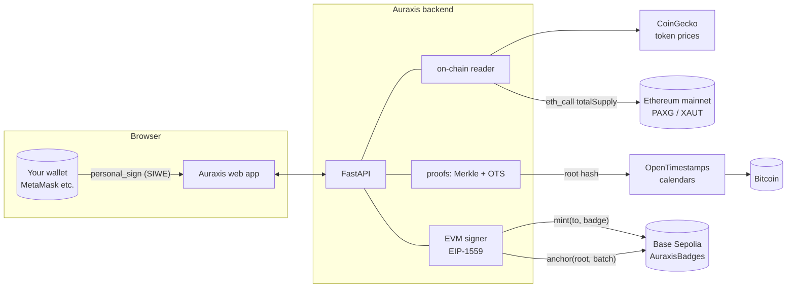

# Web3 and blockchain in Auraxis

Auraxis is an MCX gold futures research dashboard. This document explains
every place it touches a blockchain: what each feature does, why it exists,
how it works under the hood, and how to run or verify it yourself.

> **In one sentence:** Auraxis *reads* real gold tokens on Ethereum, *proves*
> research with Bitcoin timestamps, lets you *link* a wallet with a free
> signature, and *publishes* soulbound badges and proof roots on a **test**
> network — without ever putting market data, demo money or personal data on
> a chain.

---

## Contents

1. [The five features at a glance](#1-the-five-features-at-a-glance)
2. [Ground rules](#2-ground-rules)
3. [How the pieces fit together](#3-how-the-pieces-fit-together)
4. [On-chain gold (PAXG, XAUT)](#4-on-chain-gold-paxg-xaut)
5. [Proof of research (Bitcoin timestamps)](#5-proof-of-research-bitcoin-timestamps)
6. [Wallet link (Sign-In with Ethereum)](#6-wallet-link-sign-in-with-ethereum)
7. [Soulbound achievement badges](#7-soulbound-achievement-badges)
8. [Proof roots on Base Sepolia](#8-proof-roots-on-base-sepolia)
9. [The smart contract](#9-the-smart-contract)
10. [Security model](#10-security-model)
11. [Live evidence](#11-live-evidence)
12. [Configuration](#12-configuration)
13. [Running and deploying it yourself](#13-running-and-deploying-it-yourself)
14. [Testing](#14-testing)
15. [Costs and limits](#15-costs-and-limits)
16. [Limitations and possible next steps](#16-limitations-and-possible-next-steps)
17. [Glossary](#17-glossary)

---

## 1. The five features at a glance

| # | Feature | Where in the app | Chain | Reads or writes? | Who pays? | Needs a wallet? |
| --- | --- | --- | --- | --- | --- | --- |
| 1 | **On-chain gold** — tokenized gold vs MCX | More → On-chain gold | Ethereum mainnet | Read only | Nobody (free reads) | No |
| 2 | **Proof of research** — tamper-evident timestamps | More → Proof of research | Bitcoin (via OpenTimestamps) | Writes one hash per batch | Free public calendars | No |
| 3 | **Wallet link** — Sign-In with Ethereum | Profile → Web3 wallet | None (off-chain signature) | Neither | Free | Yes (optional) |
| 4 | **Soulbound badges** — achievements as NFTs | Practice → Achievements | Base Sepolia (test network) | Writes a mint | Auraxis (test gas) | Yes, to receive |
| 5 | **Proof roots on-chain** — a fast second witness | Proof of research | Base Sepolia (test network) | Writes one hash per batch | Auraxis (test gas) | No |

Every feature is **optional** and switches off cleanly if its settings are
missing; the rest of the app keeps working.

---

## 2. Ground rules

These were design constraints from day one, and the code enforces them:

- **No market data on-chain.** MCX prices and volumes never leave the server
  except through the normal API.
- **Demo money never touches a chain.** Practice balances have no cash value
  and can't be tokenized, traded or transferred.
- **Only hashes are published.** Proofs put a 32-byte Merkle root on-chain —
  never a record, a name or an email. Records are salted so a hash can't be
  matched to a guessed record.
- **Writes happen only on a test network.** Badges and anchors use Base
  Sepolia, where tokens have no monetary value. Mainnet is used *only to read*
  public gold-token data.
- **Users never pay and never sign transactions.** Linking a wallet is a free
  signature; the server pays all (test) gas for badges and anchors.
- **Secrets stay secret.** The server's signing key lives only in the
  host's encrypted environment variables (never in git).

---

## 3. How the pieces fit together



Everything blockchain-related runs in the backend as small background loops
started with the app (`backend/app/main.py`). The browser only talks to the
Auraxis API — plus your wallet extension, and only when you link a wallet.

---

## 4. On-chain gold (PAXG, XAUT)

**What you see.** *More → On-chain gold* compares MCX gold with two gold
tokens on Ethereum, each backed by one fine troy ounce of physical gold:

| Token | Issuer | Contract (Ethereum mainnet) |
| --- | --- | --- |
| PAXG — PAX Gold | Paxos | `0x45804880De22913dAFE09f4980848ECE6EcbAf78` |
| XAUT — Tether Gold | Tether | `0x68749665FF8D2d112Fa859AA293F07A622782F38` |

The page shows the token prices, their **circulating supply read directly
from the blockchain**, what that gold would cost **landed in India**
(parity), the gap between each MCX product and that parity, and a year of
daily gap history.

**Why it matters.** It answers a real question for an MCX trader: *is Indian
exchange gold cheap or expensive compared with globally traded, on-chain
gold?*

**How it works.**

- **Supply** comes straight from each token's ERC-20 contract over public
  JSON-RPC (`eth_call` to `totalSupply()` and `decimals()`; default node
  `https://ethereum-rpc.publicnode.com`), refreshed every 10 minutes. No API
  key or wallet is involved.
- **Prices** (INR and USD) come from CoinGecko.
- **Parity per 10 g** = token price ÷ 31.1034768 g × 10 × (1 + India's import
  duty on that date). The duty schedule is configurable
  (`ONCHAIN_DUTY_SCHEDULE`).
- History pairs a year of daily token prices with MCX settlement prices.

Code: `backend/app/data/onchain.py`, `backend/app/api/onchain.py`,
`frontend/src/pages/OnchainPage.tsx`.

---

## 5. Proof of research (Bitcoin timestamps)

**What it does.** Proves that a research note or a closed practice trade
**existed at a certain time and hasn't been changed since** — and anyone can
check it without trusting Auraxis.

**The user's view.**

1. **Certify** — closed practice trades are certified automatically; research
   notes have a *Certify on Bitcoin* button.
2. **Seal** — about every hour, all new fingerprints are combined into one
   Merkle root.
3. **Anchor** — the root is sent to free **OpenTimestamps** calendars, which
   fold it into a Bitcoin transaction within a few hours.
4. **Share and verify** — download a proof file; anyone can check it on the
   *Verify a proof* panel (no login), or independently at
   [opentimestamps.org](https://opentimestamps.org) using the `.txt` and
   `.ots` files.

Status moves *Queued → Waiting for Bitcoin → Anchored in Bitcoin* (with the
block height).

**How it works.**

```text
leaf = SHA256("auraxis-proof-leaf-v1\0" ‖ 32-byte random salt ‖ exact JSON of the record)
node = SHA256(0x01 ‖ left ‖ right)          (an odd node is promoted unchanged)
```

- The prefixes give **domain separation**: a leaf can never pose as an inner
  node (this blocks second-preimage tricks on the tree).
- The **salt** stops anyone matching a published hash to a guessed record.
- Only the **root** leaves the server. The calendars never see records.
- The backend keeps upgrading pending timestamps (every 30 minutes), checks
  the final attestation against the real Bitcoin block header, and follows
  upgrade links only on known calendar domains (`*.calendar.opentimestamps.org`,
  `*.calendar.eternitywall.com`, `*.calendar.catallaxy.com`).

**A proof file** contains the record's exact JSON, its salt, its Merkle path,
the batch root, and the `.ots` timestamp. Verification shows each check:

| Check | Meaning |
| --- | --- |
| Fingerprint matches the record | Hashing salt + JSON gives the stated leaf |
| Merkle path leads to the root | Hashing up the path reproduces the batch root |
| Root published by Auraxis | This server sealed that root |
| Timestamp commits to the batch | The `.ots` file commits to the stamped document |
| Anchored in Bitcoin | The commitment is in a real Bitcoin block (after a few hours) |
| Published on Base Sepolia | The root is also recorded in the Auraxis contract (section 8) |

Change a single character of the record and the proof becomes **Not valid**.

Code: `backend/app/data/proofs.py`, `backend/app/api/proofs.py`,
`frontend/src/pages/ProofsPage.tsx`.

---

## 6. Wallet link (Sign-In with Ethereum)

**What it does.** Lets you attach an Ethereum address to your Auraxis account
by proving you control it. Nothing in Auraxis *requires* a wallet; linking
one lets you receive achievement badges.

**The user's view.** *Profile → Web3 wallet → Connect wallet*, pick an
account, and sign the message your wallet shows. Signing is **free**: no
transaction, no gas, no access to funds. **Unlink** any time.

**How it works.** The server issues a standard **EIP-4361 (Sign-In with
Ethereum)** message:

```text
auraxis-ten.vercel.app wants you to sign in with your Ethereum account:
0xYourAddress

Link this wallet to your Auraxis account. Signing is free and does not allow any transaction or transfer.

URI: https://auraxis-ten.vercel.app
Version: 1
Chain ID: <your wallet's network>
Nonce: <24 random characters>
Issued At: <time>
Expiration Time: <time + 10 minutes>
```

- The wallet signs it with `personal_sign` (**EIP-191**).
- The server recovers the signer's public key from the secp256k1 signature
  and derives the address (**EIP-55** checksum). It links the wallet only if
  that address matches and the nonce is unused and unexpired.
- Each challenge is **single-use** and expires after **10 minutes**, so a
  captured signature can't be replayed.
- One wallet can be linked to only one Auraxis account.

Code: `backend/app/data/ethsig.py`, `backend/app/api/wallet.py`,
`frontend/src/lib/wallet.ts`, `frontend/src/components/WalletCard.tsx`.

---

## 7. Soulbound achievement badges

**What it does.** Practice trading has five achievements. Once you've earned
one and linked a wallet, **Claim NFT** mints it to your wallet as a
**soulbound** token — it proves the achievement is yours and can never be
sold or transferred.

| Badge id | Achievement | How to earn it |
| --- | --- | --- |
| 0 | First trade | Place your first practice trade |
| 1 | Pair trader | Trade a gap between two products |
| 2 | Gap hunter | Trade a pair while its gap is unusual (beyond 2σ) |
| 3 | In the green | Close a trade with a profit after costs |
| 4 | Regular | Close ten practice trades |

**The user's view.** The chip under each earned achievement changes:
*Claim NFT* → *Minting… ↗* (links to the transaction) → *On-chain ✓ #id*
(links to the token on BaseScan). Without a linked wallet it reads *Link a
wallet to claim*.

**How it works.**

1. `POST /api/badges/{code}/claim` checks that the achievement is really
   earned, a wallet is linked, and web3 is active.
2. It reads the contract first (`tokenOfBadge(wallet, badge)`), so a badge
   already minted is never minted twice.
3. The server signs and sends `mint(wallet, badge)`; the claim is stored as
   *pending* with the transaction hash.
4. A background loop (every 15 s) waits for the receipt and reads the token
   id from the ERC-721 `Transfer` event, then marks it *minted*.

The token's metadata (name, description, attributes) is generated **on-chain**
as a `data:` JSON URI — no external server or IPFS is needed.

Code: `backend/app/data/web3.py`, `backend/app/api/badges.py`,
`frontend/src/lib/badges.ts`, `frontend/src/pages/PracticePage.tsx`.

---

## 8. Proof roots on Base Sepolia

**What it does.** Bitcoin takes hours to confirm a timestamp. So every sealed
proof root is **also** written to the Auraxis contract on Base Sepolia, usually
within a minute — a fast, public second witness. Bitcoin remains the
long-term anchor.

**How it works.**

- After a batch is sealed, the web3 loop calls `anchoredAt(root)`; if the
  root isn't recorded yet it sends `anchor(root, batchId)`. (Checking first
  makes the step safe to repeat.)
- The contract stores `anchoredAt[root] = block.timestamp` and emits
  `Anchored(root, batchId, timestamp)`.
- Proof details show *Also published on Base Sepolia* with the block number,
  and **Verify** reads `anchoredAt` straight from the chain for the
  *Published on Base Sepolia* check.

---

## 9. The smart contract

`backend/contracts/AuraxisBadges.sol` — Solidity 0.8.28, optimizer 200 runs,
EVM `cancun`. The compiled ABI and bytecode are in
`backend/contracts/AuraxisBadges.json`.

| Item | Value |
| --- | --- |
| Network | Base Sepolia (chain id 84532) |
| Address | [`0x7256a51Ba02FE20Bbca1Df2FA96322B5a794f884`](https://sepolia.basescan.org/address/0x7256a51Ba02FE20Bbca1Df2FA96322B5a794f884) |
| Name / symbol | Auraxis Practice Badges / AXB |
| Standards | ERC-165, ERC-721, ERC-721 Metadata, **ERC-5192** (soulbound) |
| Operator | The Auraxis server address, fixed at deployment (`immutable`) |

**Functions.**

| Function | Who can call | What it does |
| --- | --- | --- |
| `mint(address to, uint8 badge)` | Operator only | Mints badge `0–4` to `to`; reverts `AlreadyMinted` if that wallet has it |
| `anchor(bytes32 root, uint256 batchId)` | Operator only | Records `anchoredAt[root]` and emits `Anchored` |
| `tokenOfBadge(address, uint8)` | Anyone (view) | Token id a wallet holds for a badge (0 = none) |
| `anchoredAt(bytes32)` | Anyone (view) | Timestamp a root was anchored (0 = never) |
| `locked(uint256)` | Anyone (view) | Always `true` (ERC-5192) |
| `tokenURI(uint256)` | Anyone (view) | On-chain JSON metadata |
| `transferFrom`, `safeTransferFrom`, `approve`, `setApprovalForAll` | — | **Always revert `Soulbound`** |

After deployment, `scripts/deploy_badges.py --verify` reads the contract back
and confirms: code present, correct operator, all four interface ids
supported, and that `transferFrom` reverts.

---

## 10. Security model

**Keys.**

- The server holds one **test-network** signing key (`WEB3_SIGNER_KEY`). It
  lives only in the host's encrypted variables (Railway) and the git-ignored
  local `.env`; it is never logged or printed.
- The key holds a tiny amount of **test ETH** with no monetary value.
- Users' keys never reach Auraxis. The wallet link uses a signature only.

**If the server key leaked**, an attacker could mint badges or anchor junk
roots on the *test* network. They could **not** move anyone's badges (the
contract forbids transfers), touch real funds, or alter existing anchors
(each root's timestamp is written once). Recovery: deploy a fresh contract
with a new key and update two variables.

**Replay and integrity protections.**

| Risk | Protection |
| --- | --- |
| Replaying a wallet signature | Single-use nonce, 10-minute expiry, domain and URI in the signed message |
| Replaying a transaction on another chain | EIP-1559 transactions include the chain id |
| Double-minting a badge | Contract rejects it (`AlreadyMinted`); server checks first |
| Nonce clashes between concurrent sends | Sends are serialised with a lock; nonce = max(pending count, next local) |
| Faking a proof | Salted leaves, domain-separated Merkle hashing, Bitcoin header check |
| Malicious timestamp calendar redirect | Upgrade URLs followed only on known calendar domains |

**Self-implemented cryptography, verified.** The backend signs Ethereum
transactions with its own small implementation (`backend/app/data/evm.py`:
RLP encoding, ABI encoding, EIP-1559 type-2 transactions, RFC 6979
deterministic nonces with SHA-256, low-s normalisation). To make sure it is
correct, the tests compare its output **byte for byte** with the reference
library `eth-account` on fixed fixtures.

---

## 11. Live evidence

A full end-to-end run on Base Sepolia (isolated test databases, throwaway
test wallet):

| Step | Result |
| --- | --- |
| Link wallet with SIWE | Linked |
| Claim the *First trade* badge | [Mint transaction](https://sepolia.basescan.org/tx/0x24aaaab3af0d7650ae6494e803562a7fbb38d5d26adde68c060169925b0e25d0) → **On-chain ✓ #1** |
| Certify a research note and seal the batch | Root [anchored](https://sepolia.basescan.org/tx/0x39ab79e879cce842284f02607cb0a5ad4e80d697a2228db316c211295ff9c48f) in block 61,377,855 |
| Verify the proof | ✓ fingerprint · ✓ Merkle path · ✓ root · ✓ timestamp · ✓ **Published on Base Sepolia** (Bitcoin pending, as expected for a fresh stamp) |

You can inspect the contract, both transactions and the token yourself on
[BaseScan](https://sepolia.basescan.org/address/0x7256a51Ba02FE20Bbca1Df2FA96322B5a794f884).

---

## 12. Configuration

All settings are environment variables (see `backend/.env.example`).

| Variable | Default | Purpose |
| --- | --- | --- |
| `ONCHAIN_ENABLED` | `true` | On-chain gold page and loops |
| `ONCHAIN_RPC_URL` | PublicNode Ethereum | JSON-RPC for token supply |
| `ONCHAIN_PRICE_API` | CoinGecko | Token prices |
| `ONCHAIN_DUTY_SCHEDULE` | built-in | India import duty by effective date |
| `PROOFS_ENABLED` | `true` | Proof of research |
| `PROOFS_BATCH_MINUTES` | `60` | How often new fingerprints are sealed (5 – 10080) |
| `PROOFS_CALENDARS` | three public calendars | OpenTimestamps calendars |
| `WEB3_CONTRACT` | empty | AuraxisBadges address; badges and anchors are **off** unless both this and the key are set |
| `WEB3_SIGNER_KEY` | empty | **Secret.** Server's test-network key |
| `WEB3_RPC_URL` | `https://sepolia.base.org` | Test-network RPC |
| `WEB3_CHAIN_ID` | `84532` | Test-network chain id |
| `WEB3_NETWORK_NAME` | `Base Sepolia` | Shown in the UI |
| `WEB3_EXPLORER` | `https://sepolia.basescan.org` | Links in the UI |

---

## 13. Running and deploying it yourself

**Features 1–3** need no setup: they work out of the box (with internet
access).

**Features 4–5** (badges and anchors):

1. Create a fresh key for the server and put it in `backend/.env` as
   `WEB3_SIGNER_KEY=0x…` (never reuse a key that holds real funds).
2. Fund its address with a little Base Sepolia test ETH from any Base Sepolia
   faucet. About 0.0001 ETH is plenty.
3. Deploy and verify the contract:

   ```powershell
   cd backend
   .venv/Scripts/python.exe scripts/deploy_badges.py
   ```

   The script refuses to run on the wrong chain or without funds, predicts the
   contract address, waits for the receipt, verifies the contract and prints
   `WEB3_CONTRACT=0x…`.
4. Add that line to `backend/.env` (and to your host's variables in
   production) and restart the backend.

To re-check an existing deployment:

```powershell
.venv/Scripts/python.exe scripts/deploy_badges.py --verify 0xContractAddress
```

To recompile the contract you need `solc` 0.8.28 (optimizer 200 runs, EVM
`cancun`); write the ABI and bytecode to `backend/contracts/AuraxisBadges.json`.

---

## 14. Testing

Run from `backend/`: `.venv/Scripts/python.exe -m pytest -q`.

- **Signatures and transactions** — RLP, ABI (`address`, `uintN`, `bytesN`),
  function selectors and EIP-1559 signing, checked byte-exact against
  `eth-account` fixtures (`tests/fixtures/eip1559_reference.json`).
- **Mock chain** — a fake node decodes each raw transaction, recovers the
  signer and enforces sequential nonces, so mint and anchor flows are tested
  end to end without a network.
- **Wallet link** — message format, signature recovery, nonce reuse and
  expiry, one-wallet-per-account.
- **Proofs** — leaf and Merkle hashing, tampering detection, calendar
  allow-list, verification checks.
- **On-chain gold** — supply decoding, parity and duty schedule, failure
  handling.

The real test-network run in section 11 complements these.

---

## 15. Costs and limits

Measured on Base Sepolia (test ETH, no real value):

| Action | Approximate cost |
| --- | --- |
| Deploy contract (once) | 0.0000047 ETH |
| Mint one badge | 0.00000054 ETH |
| Anchor one proof root | 0.00000036 ETH |

The server wallet's current balance (about 0.00009 test ETH) covers roughly
**170 mints or 250 anchors**; faucets top it up for free. One anchor covers a
whole batch (up to 5,000 records), so anchoring cost does not grow with the
number of users.

---

## 16. Limitations and possible next steps

- **Test network only.** Badges and anchors live on Base Sepolia. Moving to a
  mainnet (for example Base) would need a funded key, a gas budget and
  monitoring. The code is chain-agnostic and needs only new settings.
- **Bitcoin is slow by design.** A Bitcoin anchor takes a few hours; the
  Base Sepolia anchor fills that gap.
- **Hot key.** The server key signs automatically. For a mainnet version, a
  managed signer (KMS/HSM) or a relayer with spending limits would be the
  safer choice.
- **Badges can't be revoked.** That is intentional for achievements that
  were genuinely earned.
- **Possible next steps:** show linked-wallet badges on a public profile
  page; let users verify a badge from its token page; add EIP-712 typed data
  for richer wallet prompts; anchor roots on a mainnet L2.

---

## 17. Glossary

| Term | Meaning |
| --- | --- |
| **Blockchain** | A public, append-only ledger that many computers keep in sync |
| **Testnet** | A practice blockchain whose coins have no value (here: Base Sepolia) |
| **Gas** | The fee paid to process a transaction; Auraxis pays it, in test ETH |
| **Wallet** | An app (e.g. MetaMask) that holds your keys and signs on your behalf |
| **Signature** | Proof that the holder of a key approved a message, without revealing the key |
| **SIWE (EIP-4361)** | A standard "Sign-In with Ethereum" message format |
| **Smart contract** | A program stored on a blockchain that anyone can call and inspect |
| **ERC-20** | Standard for fungible tokens (PAXG and XAUT) |
| **ERC-721 / NFT** | Standard for unique tokens |
| **Soulbound (ERC-5192)** | An NFT that is permanently locked to its owner |
| **Hash (SHA-256)** | A 32-byte fingerprint; any change to the input changes it completely |
| **Salt** | Random bytes added before hashing so the hash can't be guessed |
| **Merkle tree / root** | Hashes combined in pairs up to one root that commits to every record |
| **OpenTimestamps** | A free, open protocol for proving data existed at a time, using Bitcoin |
| **PAXG / XAUT** | Gold-backed tokens; one token = one fine troy ounce |
| **Parity** | What on-chain gold costs per 10 g landed in India, including import duty |
